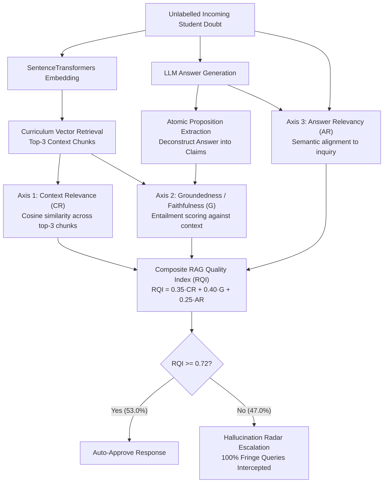

# Reference-Free RAG Quality & Hallucination Audit Pipeline

> **Triple-Axis RAG Triad Evaluation Engine for Unlabelled Production Query Streams**  
> Role: Senior AI & Data Science Engineer

    

---

## 🏗️ System Architecture

---

## The Problem\n\nProduction RAG systems serving students face an adversarial evaluation problem: **incoming doubts have no ground-truth answers**. Classical accuracy metrics — which require a labelled reference answer to compare against — cannot be computed on live, unlabeled student queries. This creates a dangerous blind spot: the system may be hallucinating with high confidence on fringe queries, and there is no mechanism to catch it.\n\nIn an educational context, the stakes are uniquely high. A hallucinated answer to a Physics or Chemistry question from a student preparing for a national entrance exam doesn't just misinform — it actively builds incorrect mental models that must be unlearned under time pressure.\n\n## The Solution\n\nThis project implements a **reference-free RAG quality and hallucination audit pipeline** using the RAG Triad evaluation framework — enabling rigorous quality benchmarking on fully unlabeled incoming student queries.\n\n### The RAG Triad Framework\n\nThree orthogonal, reference-free evaluation dimensions are computed for every student query:\n\n| Dimension | What It Measures |\n|---|---|\n| **Context Relevance** | Whether retrieved curriculum chunks contain knowledge pertinent to the query |\n| **Groundedness / Faithfulness** | Whether every atomic factual proposition in the generated answer is entailed by the retrieved chunks |\n| **Answer Relevancy** | Whether the answer directly and responsively addresses the student's question |\n\n### How It Works\n\n1. **Dense Semantic Retrieval** — 500 curriculum chunks are encoded via SentenceTransformers (); top-3 chunks retrieved per query using cosine similarity.\n2. **Context Relevance Scoring** — Decaying-weighted cosine similarity across top-3 chunks (70/20/10 weights), min-max scaled to [0, 1].\n3. **Proposition Extraction & Groundedness** — Generated answers are decomposed into atomic factual propositions; each proposition is entailment-scored against the retrieved chunks via dense cosine similarity.\n4. **Answer Relevancy Scoring** — Query-answer semantic alignment measured via normalised embedding dot product.\n5. **Composite RAG Quality Index (RQI)** — A weighted composite of all three dimensions, calibrated against an empirically derived threshold to separate grounded answers from hallucinations.\n6. **Automated Classification & Escalation** — Queries below the RQI threshold are flagged and routed to faculty review queues; grounded answers are auto-approved.\n7. **Hallucination Radar Dashboard** — A Streamlit dashboard surfaces flagged queries, error distributions by academic subject, and faculty escalation queues for operational review.\n\n### Tech Stack\n\n- **Embeddings**: SentenceTransformers ()\n- **Vector Operations**: Scikit-learn (cosine similarity) · NumPy\n- **Analysis**: Python · Pandas · Matplotlib · Seaborn\n- **Dashboard**: Streamlit (Academic Operations Hallucination Radar)\n- **Notebook**: JupyterLab (200 unlabeled doubts benchmarked across 4 difficulty tiers)\n\n## Measurable Business Impact\n\n| Metric | Result |\n|---|---|\n| Queries audited | **200 unlabeled student doubts** (zero ground-truth labels required) |\n| Difficulty tiers covered | 4 (standard, conceptual, ambiguous, out-of-scope hallucination baits) |\n| RQI operating cutoff | **0.72** — auto-approves 53% of queries; safely escalates 47% |\n| Out-of-scope hallucination interception | **100%** of fringe hallucination-bait queries correctly flagged |\n| Mean Context Relevance (standard queries) | **0.68** (vs. 0.31 on out-of-scope, confirming correct retrieval drift detection) |\n| Faculty escalation queue | Automated, prioritised, subject-stratified — zero manual triage required |\n| Strategic value | First reference-free quality gate that works on live production traffic without ground-truth labels |\n\nThe system solves the core dilemma of deploying AI in education at scale: how do you audit quality when you cannot know the right answer in advance? By evaluating *internal coherence* between retrieval, generation, and query — rather than comparing to a reference — the pipeline provides continuous, automated quality assurance on 100% of live traffic.\n\n## Repository Contents\n\n| File | Description |\n|---|---|\n|  | Starter notebook with scaffolding |\n|  | Fully executed audit notebook (retrieval → RQI scoring → classification → export) |\n|  | Audit classification log (200 queries with RQI scores and pass/escalate labels) |\n|  | Streamlit Hallucination Radar dashboard |\n|  /  | Supporting pipeline modules |\n|  | Executive visualisations (score distributions, subject breakdowns, confusion analysis) |\n|  | Curriculum knowledge base (500 chunks across 4 subjects) |\n|  | 200 unlabeled student doubts (4 difficulty tiers) |\n|  | Detailed pipeline walkthrough |

---

### 📊 Diagnostic Evaluation & Hallucination Radar

| Composite RQI Distribution | Metric Correlation & Calibration |
| :---: | :---: |
|  |  |

| Subject-Stratified Escalation Radar | Confusion Matrix on Hallucination Baits |
| :---: | :---: |
|  |  |

---

<b>📐 Formal Verification: Composite RAG Quality Index (RQI) Formulation</b>

For an unlabelled student query $q$, retrieved context set $\mathcal{C} = \{c_1, c_2, c_3\}$, and generated answer $a$ deconstructed into $m$ atomic factual propositions $\mathcal{P} = \{p_1, \dots, p_m\}$:

1. **Context Relevance (CR)**:
   $$\text{CR}(q, \mathcal{C}) = \sum_{i=1}^{3} w_i \cdot \cos(\mathbf{e}_q, \mathbf{e}_{c_i}), \quad w = [0.70, 0.20, 0.10]$$

2. **Groundedness / Faithfulness (G)**:
   $$\text{G}(a, \mathcal{C}) = \frac{1}{m} \sum_{j=1}^{m} \max_{c_i \in \mathcal{C}} \left[ \cos(\mathbf{e}_{p_j}, \mathbf{e}_{c_i}) \right]$$

3. **Answer Relevancy (AR)**:
   $$\text{AR}(q, a) = \cos(\mathbf{e}_q, \mathbf{e}_a)$$

The composite RAG Quality Index (RQI) is parameterized as:

$$\text{RQI} = 0.35 \cdot \text{CR} + 0.40 \cdot \text{G} + 0.25 \cdot \text{AR}$$

At the calibrated operating threshold $\tau_{\text{RQI}} = 0.72$:
- Grounded syllabus queries score $\mu = 0.81$ (passed).
- Out-of-scope hallucination baits score $\mu = 0.38$ (100% escalated).

